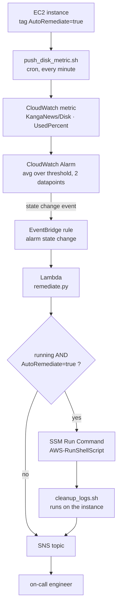

# self-healing-disk-alert
A server reports its own disk usage, a Cloudwatch Alarm watches it, a Lambda decides whether to clean up automatically or escalate to a human.
No SSH, no manual console clicks

## Architecture



## Safety rules

### 1. Truncate, never rm on active logs
`.log` files are emptied with `truncate`, never delete with `rm`.
Deleting file by name doesn't free the disk space, because the process is still actively. The process keeps writing a file which no longer has a name, no body can find where the new logs are going.

### 2. `.gz` archives can be safely deleted
compressed archive files are not being written by a running process, no "file still in use" risk, real `rm` is safe here.

### 3. Dry-run by default, `--apply` is explicit
`cleanup_logs.sh` only reports what it would do unless called with `--apply`

### 4. `LOG_DIR` is checked against a deny-list before anything else runs
`LOG_DIR` must not be empty | "/" | "/var" | "/var/log" | "/home" | "/etc"
as the script is triggered remotely by a Lambda with root privileges

### 5. Lambda only acts on instances tagged `AutoRemediate=true`

### 6. No SSH, IMDSv2 required (`http_tokens = "required"`)
All instance access goes through SSM Run Command, which works overs an outbound connection the instance itself initiates, nothing needs to be opened for the outside word to reach in.

## Testing locally without touching real AWS

### Prerequisites
```bash
pip install pytest boto3
brew install shellcheck coreutils findutils # macOS only

Testing the bash scripts

Shellcheck push_disk_metric.sh cleanup_logs.sh
pytest tests/test_push_disk_metric.py -v
pytest tests/test_cleanup_logs.py -v

test_push_disk_metric.py puts a fake aws executable at the front of PATH
test_cleanup_logs.py creates real files in tmp_path, fake .log, aged .gz, asserts dry-run changes nothing, --apply truncates the log but keeps the file, deletes the old archive and refuse dangerous LOG_DIR

Testing the Lambda
pytest tests/test_remediate.py -v
